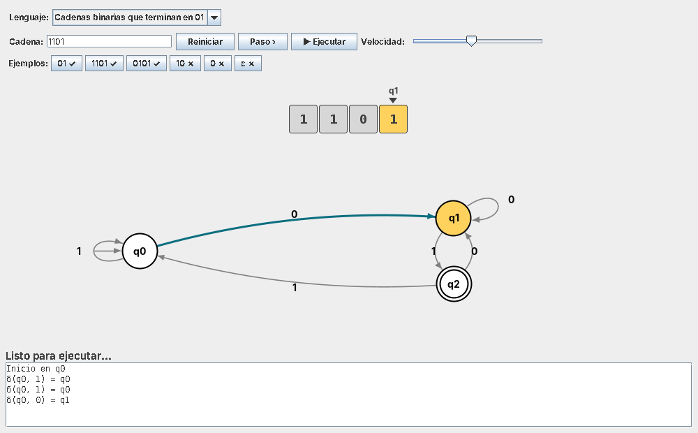
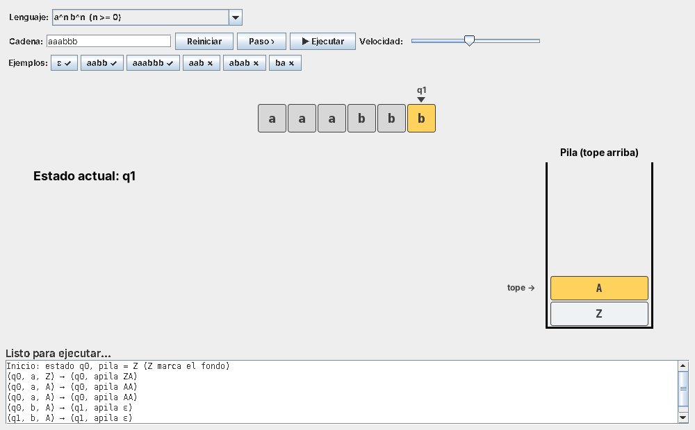
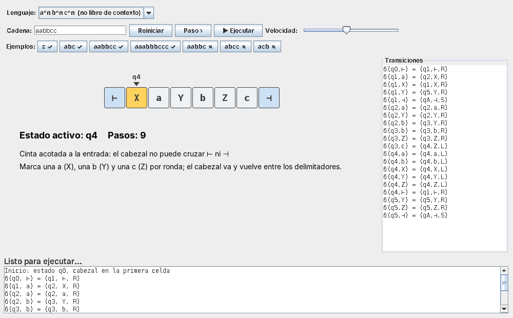
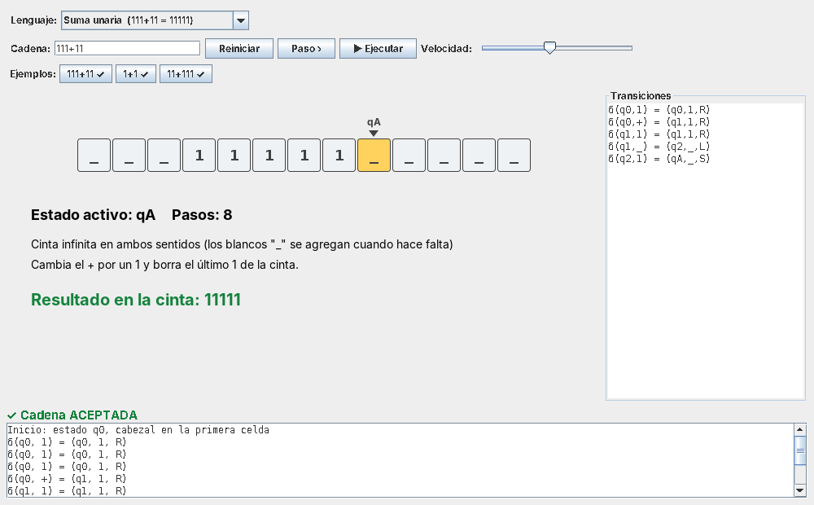

# Simulador interactivo de la jerarquía de Chomsky

Aplicación de escritorio con interfaz gráfica (Java Swing) que permite visualizar, simular y validar los modelos computacionales de los cuatro niveles de la jerarquía de Chomsky. El usuario elige un nivel en una pestaña, escribe una cadena (o usa un ejemplo) y la ejecuta paso a paso o con animación.

**Autor:** [Tu nombre completo] · **Asignatura:** [Nombre de la materia] · **Proyecto tercero**

## Módulos

| Nivel | Modelo | Qué muestra la interfaz |
|---|---|---|
| 3 · Regulares | Autómata finito determinista (AFD) | Diagrama de estados; resalta el estado actual y la transición usada al procesar la cadena símbolo a símbolo. Incluye un modo **Personalizado** para definir el propio autómata. |
| 2 · Libres de contexto | Autómata de pila | Pila animada (tope resaltado) y registro de transiciones mientras se consume la cadena. |
| 1 · Sensibles al contexto | Autómata linealmente acotado | Cinta limitada por los delimitadores ⊢ y ⊣, con el movimiento bidireccional del cabezal. |
| 0 · Recursivamente enumerables | Máquina de Turing | Cinta extensible, alfabeto de la cinta, cabezal de lectura/escritura, estado activo y tabla de transiciones. |

## Requisitos

- Java JDK 17 o superior (desarrollado y probado con Java 21).
- No usa librerías externas: solo Swing, que ya viene con el JDK.

## Cómo ejecutarlo

### Opción A: Eclipse

1. Clona o descarga este repositorio.
2. En Eclipse: `File > Import > General > Existing Projects into Workspace` y selecciona la carpeta del proyecto.
3. Clic derecho sobre `src/Chomsky/Main.java` → `Run As > Java Application`.

### Opción B: línea de comandos

Desde la carpeta raíz del proyecto:

```bash
javac -encoding UTF-8 -d bin src/Chomsky/*.java
java -cp bin Chomsky.Main
```

> Si el proyecto incluye un `module-info.java`, elimínalo o compila sin él; no es necesario para este programa.

## Cómo usarlo

1. Elige la pestaña del nivel.
2. Selecciona el **lenguaje** en la lista desplegable.
3. Escribe una **cadena** (vacía = ε) y pulsa Enter, o haz clic en uno de los **ejemplos**: ✓ significa que se acepta y ✗ que se rechaza.
4. **Paso ›** avanza una transición; **▶ Ejecutar** anima toda la ejecución (la barra *Velocidad* la ajusta); **Reiniciar** vuelve al inicio.
5. El resultado (ACEPTADA / RECHAZADA) aparece debajo, junto al registro de transiciones.

### Autómata personalizado (nivel 3)

En el lenguaje *Personalizado* aparece un cuadro de texto a la derecha con este formato (un elemento por línea):

```
inicio: q0
final: q2
q0,0,q1
q0,1,q0
q1,0,q1
q1,1,q2
q2,0,q1
q2,1,q0
```

Cada transición es `origen,símbolo,destino`. Puede haber varios estados finales separados por coma (`final: q1,q2`). El diagrama se redibuja al escribir.

## Cadenas de prueba

(También están como botones de ejemplo dentro de la interfaz.)

| Nivel | Lenguaje | Se aceptan | Se rechazan |
|---|---|---|---|
| 3 | Termina en 01 | `01`, `1101`, `0101` | `10`, `0`, ε |
| 3 | Cantidad par de 1s | ε, `1001`, `0110` | `111`, `10` |
| 3 | Contiene `aba` | `baba`, `aabab` | `abba`, `bbb` |
| 2 | aⁿbⁿ | ε, `aabb`, `aaabbb` | `aab`, `abab`, `ba` |
| 2 | Paréntesis balanceados | `([]{})`, `(()())` | `(]`, `(()`, `())` |
| 2 | w c wᴿ | `abcba`, `abbcbba`, `c` | `abcab`, `abab` |
| 1 | aⁿbⁿcⁿ | ε, `abc`, `aabbcc`, `aaabbbccc` | `aabbc`, `abcc`, `acb` |
| 0 | Incrementar binario | `1011` → `1100`, `111` → `1000` | (siempre termina) |
| 0 | Suma unaria | `111+11` → `11111`, `1+1` → `11` | (siempre termina) |
| 0 | 0ⁿ1ⁿ | ε, `01`, `0011` | `001`, `0101` |

## Estructura del proyecto

```
src/Chomsky/
├── Main.java         # Ventana principal con las 4 pestañas
├── PanelBase.java    # Clase abstracta: controles, ejemplos, animación y utilidades de dibujo
├── PanelAFD.java     # Nivel 3: autómata finito
├── PanelPila.java    # Nivel 2: autómata de pila
└── PanelTuring.java  # Niveles 1 y 0: cinta acotada / cinta infinita
docs/                 # Capturas de pantalla
```

## Capturas

| Nivel 3 | Nivel 2 |
|---|---|
|  |  |
| **Nivel 1** | **Nivel 0** |
|  |  |

## Documentación

La explicación de la implementación y de los conceptos aplicados está en el documento `Documento_Proyecto_Chomsky.docx`.